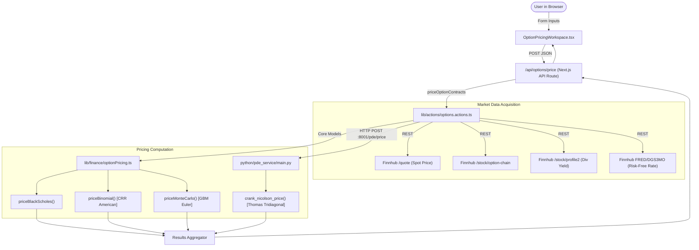

# Phase 0: Comprehensive Repository & Quantitative Audit

## 1. Executive Summary & Inventory
The existing workspace (`a:\quant\SwiftIq_Finance`) is an early-stage Next.js / TypeScript stock tracking application with an initial "Options Lab" prototype and a standalone Python PDE pricing microservice. 

Currently, it provides:
- Live stock market overview widgets (TradingView embed).
- News fetching, search, and user authentication (Better-Auth + MongoDB).
- An options pricing workspace allowing users to price single equity options using Black-Scholes, Binomial Tree (CRR), Monte Carlo (GBM), and an external Crank-Nicolson PDE FastAPI service.

---

## 2. Technology Stack Inventory

| Domain | Technology / Library | Version / Details | Purpose in Current System |
|---|---|---|---|
| **Frontend Framework** | Next.js (App Router), React | Next 15.5.2, React 19.1.0 | Core UI rendering, SSR, API routes |
| **Styling & UI** | Tailwind CSS v4, Radix UI Primitives, Lucide Icons | `@tailwindcss/postcss ^4`, `@radix-ui/*` | Design system, form controls, layout |
| **Backend / API** | Next.js Server Actions & Route Handlers, Python FastAPI | FastAPI 0.1.x, Uvicorn, Next.js API routes | Web API & option calculation orchestration |
| **Programming Languages** | TypeScript, Python | TS 5.x (Node v22), Python 3.10/3.13 | TS for full-stack, Python for PDE service |
| **Numerical Libraries** | Custom TS math functions, NumPy in Python | NumPy 1.26+/2.x, Abramowitz-Stegun TS erf | Mathematical calculations, PDE linear solver |
| **External APIs** | Finnhub Stock & Options API, FRED Treasury Rates | Finnhub REST (`/quote`, `/option-chain`, `/economic`) | Market quotes, risk-free rates, dividend yield |
| **Authentication & DB** | Better-Auth, Mongoose, MongoDB | MongoDB 6.19, Mongoose 8.18 | User accounts, watchlist persistence |
| **Background Processing**| Inngest, Nodemailer | Inngest 3.40.1, Nodemailer 7.0.6 | Daily email news triggers |
| **Testing Frameworks** | **NONE** | No Jest, Vitest, Pytest, or quantitative test suites | Only a basic script testing MongoDB connection |

---

## 3. Current Architecture & Data Flow

### Architectural Flaws & Coupling:
1. **No Domain Model for Portfolio / Positions**: The system only knows how to price a single standalone option contract at a time. No concept of a portfolio, positions, weights, factor sensitivities, or multi-asset holdings.
2. **Pricing coupled to HTTP Fetching**: `priceOptionContracts` in `options.actions.ts` interweaves market data fetching from Finnhub, input extraction, and model execution. Quant logic cannot be run offline or in backtests without mock network requests.
3. **Dual Language Fragmentation**: Core models are in TypeScript, while PDE is in Python. If Python service is offline, Next.js catches the error and degrades with a warning banner, but maintaining pricing parity across two languages without shared test fixtures creates drift.
4. **Monolithic UI Component**: `OptionPricingWorkspace.tsx` (641 lines) contains raw form state, parsing, submission logic, card layouts, and formatting with no reusable risk widgets.

---

## 4. Quantitative Model Deep Dive & Mathematical Validation

### A. Black-Scholes Formula (`lib/finance/optionPricing.ts`)
- **Equations & Formulation**:
  - $d_1 = \frac{\ln(S/K) + (r - q + \frac{1}{2}\sigma^2)T}{\sigma\sqrt{T}}$
  - $d_2 = d_1 - \sigma\sqrt{T}$
  - Call Fair Value: $C = S e^{-q T} N(d_1) - K e^{-r T} N(d_2)$
  - Put Fair Value: $P = K e^{-r T} N(-d_2) - S e^{-q T} N(-d_1)$
- **Validation**:
  - Formulas for fair value are mathematically correct.
  - Put-call parity holds analytically: $C - P = S e^{-q T} - K e^{-r T}$.
  - Analytical Greeks:
    - Delta, Gamma, Vega, Rho are correct.
    - Theta Put formula has the correct sign handling for dividend yield and interest rate discounting.
- **Flaws & Edge Cases**:
  - **Artificial Time Clamping**: `clampTime` clamps $T \ge 1/365$ (1 day minimum). This severely distorts near-expiry (0DTE/intraday) contracts. At $T \to 0$, options must asymptotically converge to intrinsic payoff $\max(S-K,0)$ / $\max(K-S,0)$.
  - **Erf Approximation Precision**: Uses Abramowitz-Stegun polynomial approximation (error $\sim 1.5 \times 10^{-7}$). For risk sensitivities (Gamma/Vega in deep OTM tails), full double precision ($\sim 10^{-16}$) is required.
  - **No Implied Volatility Solver**: The codebase assumes IV is either provided by Finnhub or defaults to 0.30 (30%). There is NO root finder (Brent / Bisection) to back out IV from traded option prices.

### B. Crank-Nicolson Finite-Difference Engine (`python/pde_service/main.py`)
- **PDE Formulation**:
  - Evolving backward in time $\tau = T - t$:
    $\frac{\partial V}{\partial \tau} = \frac{1}{2}\sigma^2 S^2 \frac{\partial^2 V}{\partial S^2} + (r-q)S \frac{\partial V}{\partial S} - rV$
  - Space discretization: Central differences on uniform grid $S \in [0, S_{\max}]$.
  - Time discretization: Crank-Nicolson semi-implicit $(\theta = 0.5)$ scheme.
  - Tridiagonal Matrix System: $A V^{j+1} = B V^j + b$.
  - Matrix solution: Thomas algorithm (`solve_tridiagonal`).
- **Validation**:
  - Tridiagonal stencil coefficients $(\alpha, \beta, \gamma)$ correctly discretize diffusion, convection, and discounting.
  - Boundary conditions correctly enforce $V(0,\tau) = 0$ (Call), $K e^{-r\tau}$ (Put) and asymptotic upper limits at $S_{\max}$.
  - Residual norm tracking is implemented.
- **Critical Numerical & Implementation Bugs**:
  - **CRITICAL BUG - Theta Greek Calculation**:
    Line 328 compares `first_step` (which is $V(\tau = \Delta\tau)$, near maturity $t = T - \Delta\tau$) with `fair_value` ($V(\tau = T)$, present day $t = 0$), dividing by $\Delta\tau$. This is completely incorrect. Theta at $t=0$ must be evaluated using the finite difference between the penultimate step $\tau = T - \Delta\tau$ and the final step $\tau = T$.
  - **Severe Performance Bottleneck (Vega / Rho)**:
    `bump_and_price` re-runs the entire Crank-Nicolson grid from $\tau = 0$ to $T$ twice for Vega and twice for Rho (4 full PDE solves per contract).
  - **Python Loop Overhead in Thomas Solver**:
    `solve_tridiagonal` runs in a native Python `for` loop across hundreds of time steps and space points, causing noticeable latency instead of utilizing compiled vectorization or SciPy banded solvers.

### C. Binomial Tree (`lib/finance/optionPricing.ts`)
- **Undocumented American Option Model**:
  - Uses Cox-Ross-Rubinstein (CRR) parameterization.
  - At line 303: `optionValues[i] = Math.max(continuation, intrinsic);`.
  - **Problem**: This prices an **American** option (allowing early exercise), whereas Black-Scholes and Crank-Nicolson are pricing **European** options. Comparing them directly in the UI confuses users because American puts on dividend/interest rate assets carry early exercise premium.

### D. Monte Carlo Option Pricing (`lib/finance/optionPricing.ts`)
- Implements standard Euler-Maruyama discretization for GBM with Box-Muller normal deviates.
- Provides basic quantile summaries (P05, P25, P50, P75, P95).
- Works for European payoffs, but unvectorized in TS (loop-based).

---

## 5. Comprehensive Problem Matrix

| Category | Specific Identified Issue | Location | Impact |
|---|---|---|---|
| **Mathematical** | PDE Theta calculates sensitivity at maturity instead of present value | `python/pde_service/main.py:327` | Invalid Theta values returned to user |
| **Mathematical** | Binomial model prices American options while other models price European | `lib/finance/optionPricing.ts:303` | Silent model discrepancy |
| **Mathematical** | Missing Implied Volatility root-finding algorithm | `lib/actions/options.actions.ts:384` | Falls back to hardcoded 30% vol if Finnhub has gaps |
| **Numerical** | Clamping time to 1 day distorting short-dated / 0DTE options | `lib/finance/optionPricing.ts:34` | Incorrect prices for near-expiry options |
| **Architecture** | Lack of Portfolio, Position, and Risk Factor abstractions | Global | Cannot perform portfolio aggregation or stress testing |
| **Architecture** | Direct coupling between API calls and quantitative pricing | `lib/actions/options.actions.ts` | Cannot test pricing engine deterministically |
| **Performance** | PDE Vega/Rho solves 4 full PDE grids per request in pure Python loops | `python/pde_service/main.py:337-387` | High latency and CPU usage |
| **Testing** | 0% test coverage for pricing models, Greeks, and data transformations | Entire repository | Critical risk of regression |
| **Product / UX** | Single-instrument focus; no multi-asset portfolio, no stress testing, no VaR | UI / Navigation | Does not meet the vision of a Risk & Stress Testing Platform |

---

## 6. Component Reuse & Disposition Plan

| Component | Disposition | Justification & Action Required |
|---|---|---|
| `lib/finance/math.ts` | **REFACTOR** | Upgrade normal CDF/PDF to high-precision Cody implementation; add inverse CDF for Monte Carlo/copulas. |
| `lib/finance/optionPricing.ts` | **REFACTOR** | Modularize into clean quant domain packages: `pricing/black_scholes`, `pricing/binomial`, `risk/greeks`, `pricing/iv`. Separate European vs American logic. Fix time clamping. |
| `python/pde_service/main.py` | **REFACTOR** | Fix Theta calculation bug; vectorize Thomas algorithm or use SciPy; provide PDE as an advanced benchmark model. |
| `types/options.ts` | **REPLACE & EXTEND**| Expand into a unified instrument model (`Instrument`, `EquityPosition`, `OptionPosition`, `Portfolio`, `Scenario`, `RiskReport`). |
| `components/options/OptionPricingWorkspace.tsx` | **REFACTOR** | Retain as an "Options Pricing Lab" under the Research / Tools tab; build dedicated Portfolio Builder and Stress Testing views. |
| `lib/actions/finnhub.actions.ts` | **REFACTOR** | Wrap behind a formal `MarketDataProvider` interface with caching, rate limiting, and mock offline capabilities. |
| `components/ui/*` | **KEEP** | Standard Radix UI + Tailwind design components; perfectly reusable for the new dashboards. |
| Better-Auth & Mongoose setup | **KEEP (Optional for V1)** | Leave intact for user profiles/watchlists; ensure V1 stress testing functions smoothly without requiring mandatory database login. |
| Inngest news cron | **KEEP** | Independent background service; no interference with quantitative risk pipeline. |
